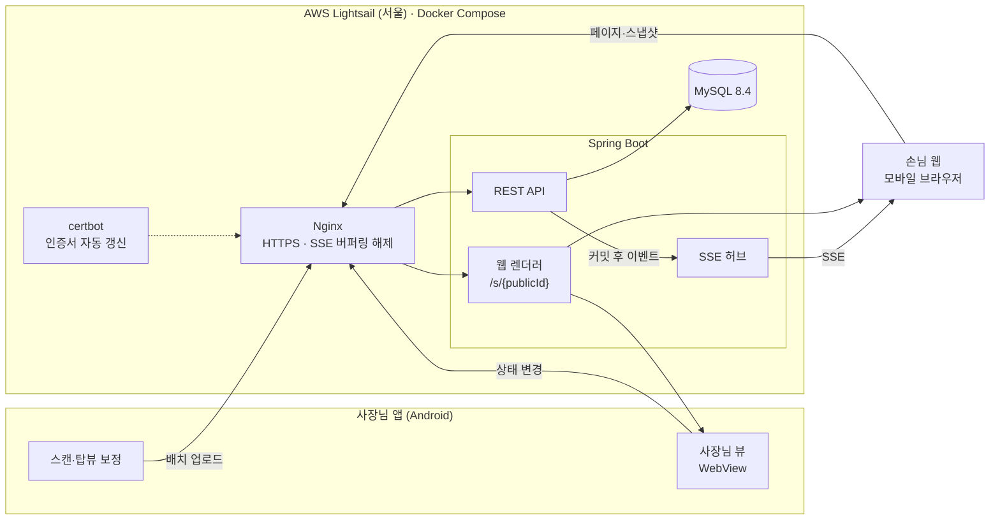

# 자리있어?! (jari-isseo-server)

> **매장을 한 번 스캔하면, 손님에게 실시간 빈자리가 보인다.**

자리있어는 손님과 가게가 같은 매장 지도를 보는 서비스입니다.
이 레포는 **서버(Spring Boot)** 와 **손님 웹**으로, 사장님 앱이 올린 배치와 테이블 상태를 저장하고, 손님에게는 앱 설치 없이 링크 하나로 실시간 빈자리를 보여줍니다.

| 구분 | 링크 |
| --- | --- |
| 운영 서버 | https://jariisseo.mingu.cloud |
| 손님 웹 | `https://jariisseo.mingu.cloud/s/{publicId}` |
| API 문서 (Swagger) | https://jariisseo.mingu.cloud/swagger-ui.html |
| 사장님 앱 저장소 | https://github.com/jari-isseo/jari-isseo-android |
| 기획 문서 (노션) | [요구사항 분석서 · API 정의서 · 개발 순서](https://app.notion.com/p/416db762435d8166b74aec1f4f8b1f4d) |

---

## 기획 배경

- **손님**: 가보기 전에는 자리가 있는지 알 수 없고, 바쁜 시간에는 가게에 전화로 물어보기도 어렵습니다.
- **가게**: POS의 테이블 번호가 매장 어디인지 처음 온 직원은 모르고, 빈자리를 알리려면 전화를 받아야 합니다.

두 문제의 원인은 하나, **매장 구조와 지금 상태가 보이지 않는다**는 것입니다.
→ **스캔으로 매장 지도를 만들고, 사장님 터치 한 번으로 손님 화면에 빈자리를 보여줍니다.**

## 사용 흐름

1. **매장 스캔·보정** (사장님 앱): 벽 → 테이블 순서로 스캔하고 탑뷰에서 보정합니다.
2. **배치 저장** (서버): 층·바닥·벽·테이블·의자를 JSON 한 덩어리로 저장합니다. (테이블 ID 유지)
3. **링크 공유**: 손님 링크·QR 을 매장 입구나 지도 앱 가게 정보, 카카오톡에 올립니다. 카톡에는 "{매장 이름} 빈자리" 미리보기가 뜹니다.
4. **손님 확인** (손님 웹): 앱 설치·로그인 없이 브라우저에서 아이소메트릭 배치도와 빈자리 수를 봅니다.
5. **상태 전환**: 사장님이 테이블을 탭하면 서버가 저장 후 SSE 로 알리고, 손님 화면이 새로고침 없이 바뀝니다.

## 시스템 아키텍처



- 사장님 앱(WebView)과 손님 웹이 같은 SVG 렌더러로 그리기 때문에, 사장님이 보는 지도와 손님이 보는 지도가 항상 같습니다.
- 인터넷에는 Nginx(80·443)만 열려 있고, 앱과 MySQL 은 서버 안에서만 접속합니다.

## 주요 기능

- **인증**: 아이디·비밀번호로 가입하면 매장이 함께 만들어짐, JWT 발급 (30일)
- **매장**: 내 매장 조회·수정 (이름, 영업 중 / 마감), 손님 공유 링크 `shareUrl`
- **배치**: 층·바닥·벽·테이블·의자 JSON 저장·조회, 다각형·ID 검증, 저장마다 `version` +1
- **테이블 상태**: 빈자리 ↔ 사용 중 변경 (같은 요청을 다시 보내도 결과가 같음), 전체 비우기
- **손님 스냅샷**: 로그인 없이 매장·배치·상태를 한 번에 조회
- **실시간 반영**: 상태·배치·매장이 바뀌면 SSE 로 손님 화면에 바로 반영, 끊기면 자동 재연결
- **손님 웹**: 아이소메트릭 배치도, 빈자리 수 카드, 층 칩, 테이블 목록, 영업 종료·배치 준비 중·정보 오래됨 안내, 링크 공유
- **사장님 모드·이미지 출력**: 같은 웹을 앱 WebView 에서 열어 테이블 탭 전달, 상태 색 없는 PNG 출력
- **링크 미리보기**: 카카오톡 등에 링크를 붙이면 "{매장 이름} 빈자리" 와 이미지 표시 (Open Graph)
- **배포**: 명령 한 줄 재배포 (실패 시 되돌림), Let's Encrypt 인증서 자동 갱신

## 기술 스택

| 구분 | 기술 |
| --- | --- |
| 언어·런타임 | Java 21 |
| 서버 | Spring Boot 4.1, Spring Web MVC, Spring Data JPA, Spring Security (JWT), Validation |
| DB | MySQL 8.4 (배치는 JSON 컬럼) |
| 실시간 | SSE (Server-Sent Events), 트랜잭션 커밋 후 이벤트 전송 |
| 손님 웹 | HTML · CSS · JavaScript, SVG 아이소메트릭 렌더러 (빌드 도구 없음) |
| API 문서 | springdoc-openapi (Swagger UI) |
| 배포 | AWS Lightsail (서울), Docker Compose, Nginx, Let's Encrypt (certbot) |

## API

| 구분 | 메서드 | 경로 | 인증 | 설명 |
| --- | --- | --- | --- | --- |
| 인증 | POST | `/api/auth/signup`, `/api/auth/login` | - | 가입(+매장 생성), 로그인(JWT) |
| 매장 | GET · PATCH | `/api/owner/store` | JWT | 내 매장 조회 · 이름/영업 상태 수정 |
| 배치 | GET · PUT | `/api/owner/store/layout` | JWT | 배치 조회 · 저장 (`version` +1) |
| 상태 | PUT | `/api/owner/tables/{tableId}/status` | JWT | 빈자리/사용 중 변경 |
| 상태 | POST | `/api/owner/tables/status/reset` | JWT | 전체 비우기 |
| 손님 | GET | `/api/public/stores/{publicId}` | - | 매장 · 배치 · 상태 스냅샷 |
| 손님 | GET | `/api/public/stores/{publicId}/events` | - | 실시간 변경 (SSE: `snapshot` · `status` · `layout` · `store` · `ping`) |
| 손님 | GET | `/s/{publicId}` | - | 손님 웹 화면 (+ og 태그) |

- 에러는 모두 `{ "code": "TABLE_NOT_FOUND", "message": "테이블을 찾을 수 없어요" }` 형식 (`global/error/ErrorCode.java`)
- 자세한 요청·응답은 Swagger 와 노션 API 정의서 참고

## 로컬 실행

1. `.env.example` → `.env` 복사 후 값 채우기 (DB 접속, `JWT_SECRET`, `PUBLIC_BASE_URL`)
2. MySQL 8 실행 (Docker: `docker compose --env-file .env -f deploy/docker-compose.dev.yml up -d`)
3. 레포 루트에서 `JariisseoApplication` 실행 → http://localhost:8080/swagger-ui.html

손님 웹만 확인할 때는 서버 없이 `static/viewer/index.html` 을 Live Server 로 열고 `?sample=snapshot` (사장님 모드 `&mode=owner`, 이미지 출력 `&mode=export`)

### 테스트

```bash
./gradlew test    # 로컬 MySQL 필요
```

인증·매장·배치 검증·상태 전환·손님 API·SSE·og 태그 테스트가 `src/test` 에 있고, `http/jariisseo.http` 로 API 전체 흐름을 한 번에 실행할 수 있습니다.

## 배포

```bash
bash deploy/deploy.sh          # 내 PC (develop): 테스트·jar 빌드 → 업로드 → 서버 재시작·응답 확인, 실패 시 되돌림
bash deploy/init-https.sh      # 서버에서 한 번: Let's Encrypt 인증서 발급 → HTTPS 전환
```

- AWS Lightsail 서울 (Ubuntu 24.04, 2GB) · Docker Compose (`deploy/docker-compose.yml`)
- 비밀값은 서버의 `deploy/.env` 에만 두고, 레포에는 `.env.example` 만 올립니다

## 패키지 구조

```
src/main/java/com/jariisseo/
├── auth/       가입·로그인, JWT
├── store/      매장, publicId
├── layout/     배치 JSON 저장·검증
├── status/     테이블 상태, 전체 비우기
├── customer/   손님 스냅샷 API, /s/{publicId} 페이지·og 태그
├── realtime/   SSE 허브, 커밋 후 이벤트 전송
└── global/     보안·JWT·Swagger 설정, 공통 에러 응답
src/main/resources/static/viewer/   손님 웹 (렌더러 · 실시간 · 앱 브리지 · 이미지 출력)
deploy/                             Docker Compose · Nginx · 배포/HTTPS 스크립트
```

## 팀원

| 이름 | 역할 | GitHub |
| --- | --- | --- |
| 이민구 | Android | [@LEEMINGU03](https://github.com/LEEMINGU03) |
| 정세헌 | Backend | [@sayhoney1023](https://github.com/sayhoney1023) |
